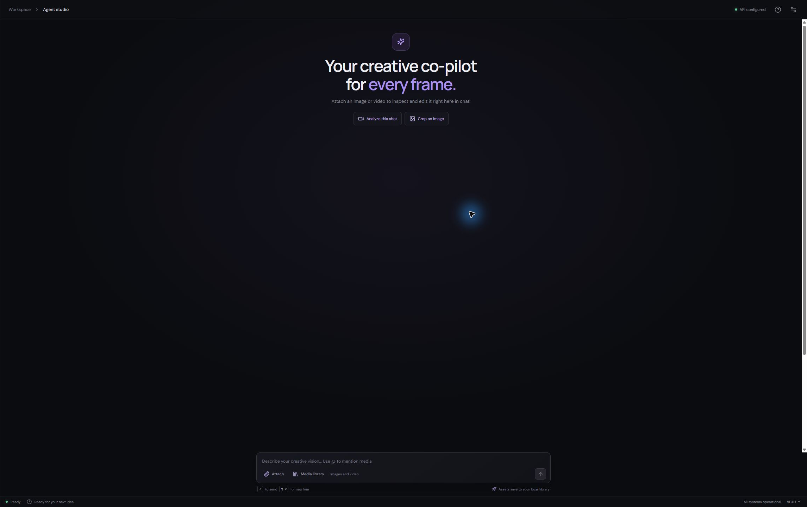

# Open SuperComputer

An open source creative workspace where you describe what you want to make, and an AI agent can inspect your media, choose a ComfyUI workflow, and help carry the edit through. Think of it as a creative agent workspace: bring a reference, give it a direction, and refine the result in chat.

## Get started

1. **Start ComfyUI** and make sure it is reachable from this computer.
2. **Run `install-open-supercomputer.bat` once** on Windows. It installs the app requirements and starts the web app plus its ComfyUI MCP service. Later, use `start-open-supercomputer.bat`. Open [http://localhost:3000](http://localhost:3000).
3. **Connect your model and ComfyUI.** Open **Model settings** (sliders icon), enter an OpenAI-compatible model provider, then enter your normal ComfyUI server URL under **ComfyUI**.
4. **Start creating.** Attach an image or video, or pick one from **Media library**. Mention it with `@` and describe the change you want. The agent can inspect references, choose a workflow, and show the render status in the workspace.

On macOS or Linux, run `bash ./start-open-supercomputer.sh` from the project folder; Node.js and `uv` must already be installed. ComfyUI runs separately on every platform.

## What you can do

- **Chat-driven image and video work:** attach media, inspect images or video frames, and ask the agent to make or refine a result.
- **Image editor:** edit an image in the chat, add bounding-box annotations, and save the edited image as a new library asset. Box coordinates are stored against the source image.
- **Video editor:** work with clips in a timeline; trim, split, remove clips, save the project, export, and extract the first or last frame.
- **Asset identity and continuity:** save descriptive tags and named character profiles to assets. The agent can reuse those references in later prompts and scenes, so identities are easier to keep consistent.
- **Local media library and chats:** uploads and edits are saved locally; assets are associated with their chats and can be referenced in follow-up work.
- **ComfyUI workflows:** discover available workflows, inspect supported inputs, submit renders, track progress, and bring outputs back into the chat.

Chat history, settings, database, and media are stored locally. On Windows, the default data folder is `%LOCALAPPDATA%\VFXGuru`; set `VFXGURU_DATA_DIR` to use another location.

## License

The app code is licensed under MIT; see [LICENSE](LICENSE). Third-party components retain their own licenses. See [THIRD-PARTY-NOTICES.md](THIRD-PARTY-NOTICES.md).
